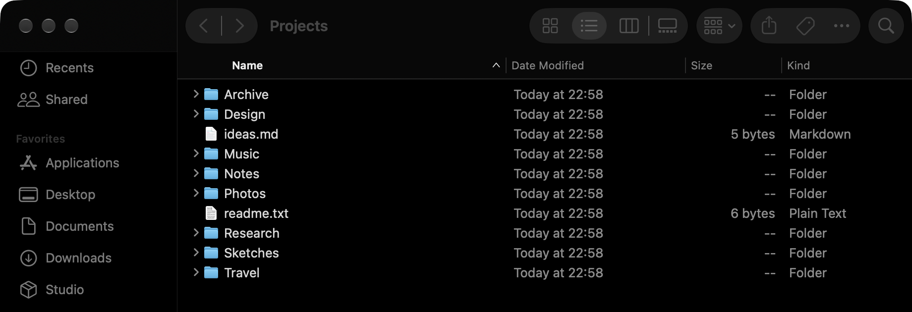
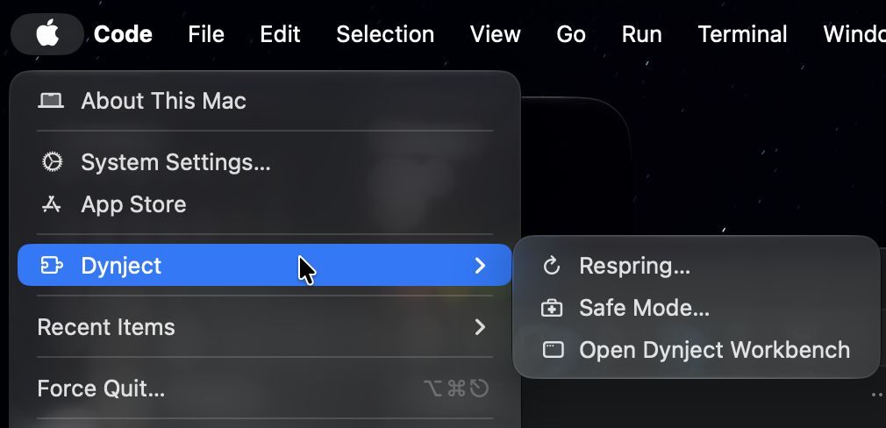
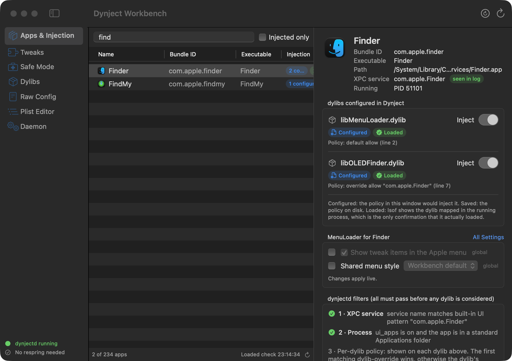

dynject-workbench
=================

tools for writing and running tweaks on macOS, on top of the dynject injector.
roughly substrate + preferenceloader + a settings app: a hooking library, a settings
sdk, an apple-menu loader, crash safe mode, respring, a cli and a native app that
manages the injector's config. no store, no packages yet.

this is free software. if you paid for it, you got scammed: ask for your money back
and report the seller with a link at https://github.com/Nininunz/dynject-workbench/issues.
same goes for paid tweaks built with this sdk.

this is alpha. it injects code into your apps. if that worries you, stop here.

screenshots
-----------

OLEDFinder, the example tweak: pure black finder, stock glass titlebar.

MenuLoader: tweaks put items in the apple menu. this is the dynject group.

workbench: what's configured for an app, what actually loaded, and why.

requirements
------------

- macOS 27 on apple silicon. the package says macOS 14+ and other setups might
  build; nobody has tried.
- xcode or the command line tools, swift 6.
- SIP relaxed, because the engine needs it: `csrutil enable --without fs --without debug`
  from recovery. see "what you're giving up" below and the engine's README.
- dynject in `/opt/dynject` (`bin/dynjectd`, `etc/dynjectd.conf`, and
  `/Library/LaunchDaemons/com.dynject.dynjectd.plist` if you want it at boot).
  we don't ship it. workbench edits its config and restarts its daemon when you
  ask; it never installs, updates or patches the engine.

the engine
----------

the injection itself is dynject by ut0mt8: https://github.com/ut0mt8/dynject (MIT).
install the engine from there. this project is a separate set of tools on top of it
and is not affiliated with or endorsed by its author.

what you're giving up
---------------------

the engine patches amfid at boot so its daemon can use restricted entitlements
(endpoint security, task_for_pid). that needs two parts of SIP turned off:

- debugging restrictions: any root process can attach to any process, apple's
  included. malware running as root gets the same power dynject has.
- filesystem protections: root can write to protected system locations (the sealed
  system volume stays sealed; authenticated root is still on).

code signing (amfi), kext signing, nvram and kernel integrity protections stay on.
apple calls this an unsupported configuration; a macOS update can break the engine or
quietly re-enable SIP. turn it back on with `csrutil enable` from recovery when you're
done. none of the tools here need SIP changes beyond what the engine asks for.

build
-----

    ./scripts/bootstrap.sh              check, build app + dw + tweaks, install to ~/Applications
    ./scripts/bootstrap.sh --check      prerequisites only
    ./scripts/bootstrap.sh --no-install build only; the app stays in build/
    ./scripts/bootstrap.sh --no-tweaks  skip MenuLoader and the examples
    ./scripts/bootstrap.sh --dest DIR   install somewhere else
    ./scripts/bootstrap.sh --help

first build takes a few minutes. it signs ad-hoc, which is all a locally built app
needs: nothing you build yourself is quarantined, so gatekeeper doesn't ask. to sign
with your own certificate:

    SIGN_IDENTITY="Apple Development: Your Name (TEAMID)" ./scripts/bootstrap.sh

(`security find-identity -v -p codesigning` lists yours.) `scripts/build-app.sh` and
every tweak's `build.sh` honour `SIGN_IDENTITY` too.

nothing in the build needs admin rights or touches the engine. installing a tweak is
a separate step and asks for your password once.

`dw` lives inside the app at `Contents/MacOS/dw`. put it on your path:

    ln -s ~/Applications/Dynject\ Workbench.app/Contents/MacOS/dw /usr/local/bin/dw

or build it alone: `swift build -c release --product dw`.

first steps
-----------

1. `open ~/Applications/Dynject\ Workbench.app`. it reads the live config at
   `/opt/dynject/etc/dynjectd.conf`; nothing is written until you click save in a
   review sheet that shows the diff.
2. workbench -> safe mode -> install watcher. no password; macos may ask you to allow
   a background item. from then on a tweak that crashes an app gets switched off for
   that app.
3. try MenuLoader in textedit, from the repo root:

       dw tweak install Tweaks/MenuLoader --for com.apple.TextEdit --dry-run
       dw tweak install Tweaks/MenuLoader --for com.apple.TextEdit

   one password prompt copies the dylib, declares and enables it in the config and
   restarts dynjectd. (or workbench -> tweaks -> install tweak...)
4. respring: `dw respring`, or the respring button in workbench. apps only load
   tweaks at launch. textedit's apple menu now has a dynject submenu.
5. write your own: `dw new MyTweak --app com.apple.TextEdit`. see TWEAKS.md.

when you break something
------------------------

- run `dw doctor` first. read-only: engine, sip, config, tweaks (macos range, depends,
  sdk build), the watcher and the bridge, the apple menu, out-of-date apps, safe mode. every `!` and `✗` comes with the
  command that fixes it. after a macos update, `dw doctor --apis` checks the private
  apis your tweaks declare they need.
- a tweak doesn't show up in one app: `dw why <tweak> <app>`. every check between the app
  launching and the tweak running, in that order, the first one that stops it, and the fix.
- hold shift while launching an app: no tweaks that launch.
- workbench -> safe mode -> panic switch (`dw safemode panic on`): no tweaks anywhere.
- crashes get your tweak switched off for that app automatically, once the watcher
  is installed.
- all three only stop tweaks built on DynjectHook. anything else: turn it off in the
  config (workbench's switches, or `dw disable <dylib> <bundleID>`).
- read the crash report. that's what it's for.
- every config and plist write is backed up first, in
  `~/Library/Application Support/Dynject Workbench/Backups/`.

what's in the box
-----------------

- Dynject Workbench: the app. which apps each dylib applies to and why, per-app
  switches, raw config editor, plist editor, daemon restart, tweak settings pages,
  tweak install, safe mode and respring. see docs/workbench.md.
- dw: the cli. install/uninstall tweaks, enable per app, respring, logs, safe mode,
  `dw doctor`, `dw why` (why a tweak doesn't load somewhere), `dw dev` (the
  build-test-install-relaunch loop, on every save), `dw hooks` (what the tweaks in a
  running app hooked, and where two clash), `dw inspect` (Inspector in background apps),
  `dw auth` (one password covers tweak installs for 5 minutes).
- DynjectHook: hooking library you compile into your tweak: objective-c methods, and any
  function by address (`DHHookFunction`, c, c++ or swift). docs/hooking.md.
- settings sdk: `DynjectTweak.h` plus a manifest gives your tweak a settings page, in
  workbench and in system settings (SettingsLoader). docs/tweak-format.md.
- MenuLoader: tweaks declare apple-menu items, it adds them. Tweaks/MenuLoader.
- SettingsLoader: every tweak's settings as a native page in system settings (tweaks, at the
  bottom of the sidebar), with system settings' own back and forward. Tweaks/SettingsLoader.
- Inspector: flex-style in-app inspector. hold ⌃⌥⌘, point at a view or layer, click: class,
  hierarchy, properties, methods, ivars, runtime browser, copy a hook skeleton. read-only.
  Tweaks/Inspector.
- safe mode: crash watcher, per-app auto-disable, panic switch. docs/safe-mode.md.
- respring: relaunch running apps whose tweaks are out of date. docs/respring.md.
- DynjectBridge: tweaks in sandboxed apps ask a user agent to set their settings, post
  notifications, open declared links. narrow, declared in the manifest. docs/bridge.md.
- TitleBadge: example tweak with every kind of setting. Examples/TitleBadge.
- OLEDFinder: example tweak, pure black finder windows, hooks, no settings. Examples/OLEDFinder.
- NotchPadding: example tweak in MenuBarAgent, keeps the menu bar's contents a set distance
  from the notch. Examples/NotchPadding.
- ClassicBattery: example tweak in ControlCenter, the menu bar battery as in older macOS, with
  live settings. Examples/ClassicBattery.

where to go next
----------------

- TWEAKS.md: writing tweaks.
- HACKING.md: changing the tools; layout, tests, how the pieces talk.
- CHANGELOG.md: what changed per version.
- KNOWN-ISSUES.md: what's broken or untested.
- TODO.md: what's missing.
- CONTRIBUTING.md: patches.
- docs/: the reference material.

license
-------

PolyForm Noncommercial 1.0.0, see LICENSE.md. free for any noncommercial use. no
selling the tools, forks of them, or tweaks built with the sdk.

free tweaks with an optional tip jar are fine. paywalled or early-access tweaks are not.
