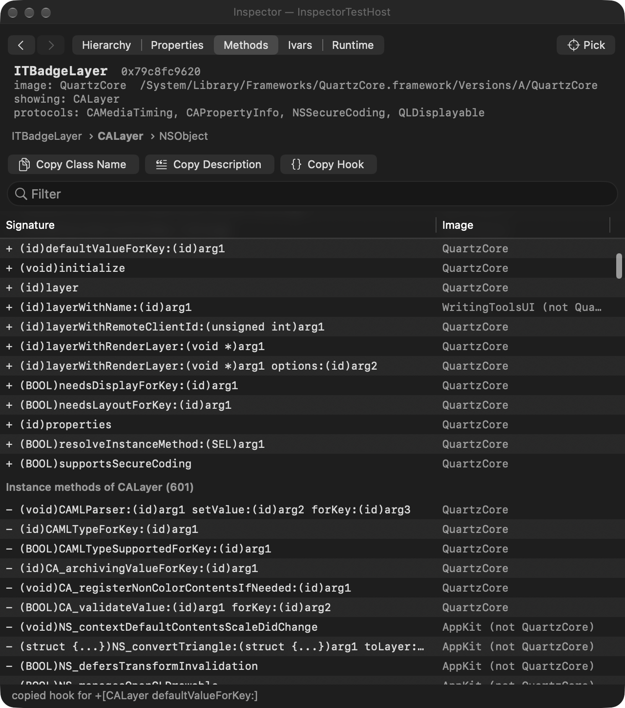

inspector
=========

an in-app inspector for macOS apps, in the spirit of FLEX. point at a view or a core
animation layer in any app it's injected into and see what it is: class, image,
superclass chain, view/layer hierarchy, properties, methods with readable signatures,
ivars, and every class loaded in the process. copy a DynjectHook skeleton for any
method, or trace it: every call logged with its arguments and return value. read-only
apart from tracing.

tweak id `local.dynject.inspector`, dylib `/opt/dynject/lib/tweaks/libInspector.dylib`,
logs under that id. no `DH_CTOR` bundle filter: the config decides which apps get it,
so enable it only for the apps you want to look inside. it hooks nothing until you trace
a method.

built with dynject-workbench's sdk: free and noncommercial; don't sell tweaks built with it.

enable for an app
-----------------

    Tweaks/Inspector/build.sh
    dw tweak install Tweaks/Inspector --for com.apple.TextEdit     # --dry-run first if you like
    dw respring                                                    # or quit and reopen the app

more apps later: `dw enable /opt/dynject/lib/tweaks/libInspector.dylib <bundleID>`, or
workbench's apps & injection page. off again: `dw disable ...` for one app,
`dw tweak uninstall local.dynject.inspector` for all.

use
---

- hold ⌃⌥⌘ while the app is frontmost: pick mode. the deepest view under the pointer
  is outlined and labelled (class, frame in window coordinates, accessibility id and
  role, layer class).
- L (keep holding, or in toggle mode just press it): layer mode. every visible core
  animation layer under the pointer in the whole window, frontmost first, labelled
  `[n/total]`, class, bounds, cornerRadius. the window's whole tree, not just the view
  under the pointer: what you see often comes from another branch (calculator's key
  glass lives in the keypad's SwiftUI.SDFLayer, not under the key's view).
- tab / shift-tab (layer mode): one layer deeper / back up. in calculator, tab a few
  times on a key to reach its `CASDFElementLayer` (60x48, cornerRadius 24) and the
  keypad's tint `CASDFLayer`s.
  L again: back to views.
- click: inspect it. the panel opens and pick mode ends. the click never reaches the app.
- let go of ⌃⌥⌘ without clicking, or press esc: cancel. ⌃⌥⌘ with another key (an app's
  shortcut) cancels too and the key goes to the app.
- apple menu → tweaks → inspect this app (needs MenuLoader): toggles pick mode in the
  frontmost app without holding keys; esc or a click ends it. it posts
  `local.dynject.inspector.toggle`; only the frontmost app with the tweak acts on it.
- the panel's pick button does the same.

the panel (an ordinary window of the app: resizable, in mission control and spaces, stays open when the app is in the background):

    header        class, pointer, image (framework or dylib) and its path, protocols.
                  superclass chain: click a class to show its properties, methods and
                  ivars ("class context").
    ◀ ▶           back / forward through what you've inspected.
    hierarchy     ancestors and children (superview/subviews, superlayer/sublayers,
                  a layer's delegate and mask, a window's views, a responder chain).
                  click to go there.
    properties    overview: a fixed set of safe getters, read automatically (frame,
                  bounds, alpha, hidden, layer, identifiers, accessibility, window title;
                  for layers position, cornerRadius/curve, opacity, masksToBounds, colors,
                  border, filters, contents class, sublayers, delegate; for CASDF* glass
                  classes their own properties). then every objective-c property of the
                  class chain with its type. click a row to read it. objects in values
                  are links.
    methods       class and instance methods of the class context as
                  `- (void)setCornerRadius:(double)arg1`, with the image each one comes
                  from ("AppKit (not QuartzCore)" = a category or someone's hook).
                  select one, Copy Hook (or right-click). Trace / Stop Trace: see below;
                  traced methods say "traced" in the image column.
    ivars         name, type, offset, for the whole chain.
    runtime       search every class in the process by substring; click to open the
                  class without an instance.
    filter        filters the current tab.

copy class name, copy description (`-description`, only when you click it) and copy
hook write to the clipboard.

copy hook gives you a hook class for DynjectHook with the exact types from the type
encoding:

    // -[CALayer setCornerRadius:]   QuartzCore   encoding v24@0:8d16
    @interface MYCALayerHook : NSObject @end
    @implementation MYCALayerHook
    - (void)setCornerRadius:(double)arg1 {
        DH_ORIG(void (*)(id, SEL, double), arg1);
    }
    @end
    // in your DH_CTOR body:
    //   DHHookClass([MYCALayerHook class], DHClass("CALayer"), NULL);

structs by value (CGRect, NSRange, CATransform3D, ...) by name, unknown structs as a
typedef with the same layout, `ns_returns_retained` / `ns_consumed` for alloc, new,
copy and init methods (docs/hooking.md), the target's nearest public superclass as the
hook's superclass so `self.frame` compiles. unions, bitfields, C arrays, structs
without a layout, `-dealloc`, retain/release and methods that look variadic (`...Format:`,
`...WithObjects:`) get a comment saying why instead. rename `MY` to your prefix. needs
`#import <QuartzCore/QuartzCore.h>` for CA types.

from the terminal: dw inspect
----------------------------

background apps (ControlCenter, the Dock, menu bar apps) are never frontmost, so the hotkey and the
apple-menu item can't reach them. `dw inspect` can:

    dw inspect ControlCenter            # open the panel there, on the app: its windows and menu bar
    dw inspect ControlCenter --pick     # pick mode there: point at its windows (menu bar items, panels), click
    dw inspect ControlCenter --stop     # end pick mode, close the panel (esc doesn't reach a background app)
    dw inspect ControlCenter --tree     # its windows and views in the terminal, no ui

`--tree` prints the app's status items (by autosave name, with their window), its FrontBoard scenes (by identifier:
ControlCenter's menu bar items are scenes), then each window (number, class, level, frame, visible, title,
identifier, accessibility label, the status item it shows) and its views from the frame view down (class, frame,
hidden, identifiers, accessibility label and, for SwiftUI hosting views, their accessibility children's labels,
layer class). KVO's hidden subclasses (`NSKVONotifying_…`) show as the class they observe, and Inspector's own
windows are left out.

`--props` adds what tells private windows apart, read with their getters: every property the windows' own classes
declare below NSWindow, and each scene's full settings. for ControlCenter's menu bar items that's
`controlCenterItemFrame`, the item's place in the menu bar; the item ids there change on every launch. the menu bar
itself is hosted by MenuBarAgent, which names the items for accessibility (`com.apple.menuextra.battery` …).

it works through a darwin notification for the app's pid (`local.dynject.inspector.command.<pid>`) whose state
carries the command and a request id; Inspector answers in the log (subsystem `dynject.inspect`). Inspector has to be
loaded in the app: the default config keeps it out of ControlCenter and the Dock (`dw why inspector <app>`).

from the terminal: dw eval
--------------------------

reads one value in a running app:

    dw eval TextEdit NSApp.windows.title             # each window's title
    dw eval TextEdit 'NSApp.windows[0].frame'        # 40,658 860x592
    dw eval MenuBarAgent NSScreen.mainScreen.frame   # a class property
    dw eval Finder NSBundle.mainBundle.infoDictionary.CFBundleVersion

a path starts at `NSApp` (or `app`) or a class name, then each step is a declared `@property` (on a class, a class
property), read with its getter (`hidden` calls `isHidden`); `[n]` or `.n`, an element of an array; `["key"]` or
`.key`, a value in a dictionary; `@count`, `@keys`, `@class`. a property step after an array is read from each
element. a method that isn't a declared property is refused, even one without arguments (`activationPolicy` is a
method in NSApplication's header, so `NSApp.activationPolicy` is refused): the path is walked step by step instead of
with `valueForKeyPath:`, because kvc calls any method whose name matches a key (`removeFromSuperview`…).

the path goes in the global preference `dynject.inspector.eval.<pid>` ({request, path, time}), then command 6 on the
notification above. a sandboxed app can read the global preferences but not write them, so only unsandboxed code
running as you can ask; a request whose number doesn't match, or older than 10 s, is refused. Inspector answers at
debug level (subsystem `dynject.inspect`, category `eval`), which only a live `log stream --level debug` sees: values
from the app are never kept in the log store. dw deletes the preference when it has the answer.

menus
-----

the panel's menus button:

- **inspect the menu bar**: the app's main menu. the hierarchy tab lists its items (title,
  shortcut, action); click one to go into it, and on into submenus.
- **pick a menu item…**: then choose any menu item, from the menu bar, a context menu or by
  its keyboard shortcut. it opens in the panel and its action isn't sent. esc cancels.

for an item, properties shows its title, key equivalent (`⇧⌘N`), action, target, and:

    sent to   <MyController 0x6000…> (the responder chain resolves it now)
    runs      -[MyController newThing:] in MyApp

`sent to` is its target, or with no target what the responder chain would deliver the action
to right now (key window, main window, the app, its delegate), or that nobody responds (so
the item is disabled). `runs` is the method that would run: click it to open that class's
methods filtered to it, right-click it to trace it. then tag, state, enabled, hidden,
alternate, represented object, submenu, menu and view.

picking hooks `-[NSApplication sendAction:to:from:]`, which every menu item sends its action
through, only while picking: the hook is switched off as soon as you pick or cancel.

trace
-----

select a method on the methods tab and press trace (or right-click → trace). every call
from then on is logged, one line each, until you press stop trace:

    -[NSButton 0x6000017a0b40 setTitle:"OK"] → void  (0.004 ms, main)
    +[NSColor colorNamed:"AccentColor"] → <NSDynamicNamedColor 0x600002b8c0c0>  (0.010 ms, main)
    → -[MyController 0x600003f4c000 reload]
      -[MyModel 0x6000021d8d80 items] → __NSArrayM (12 items)  (0.002 ms, main)
    ← -[MyController reload] → void  (0.310 ms, main)

receiver, arguments by name, return value, duration and thread. a traced call made inside
another opens with → and closes with ←, indented. arguments and results are described
the same way as properties (no `-description`; structs field by field). an exception
passing through is logged as `raised <name>` and goes on as before.

    dw log local.dynject.inspector 5                    # the last 5 minutes
    log stream --level default --predicate 'subsystem == "local.dynject.inspector" && category == "trace"'

right-click a method for: trace all methods of <class> (the ones that class itself
defines, up to 400), stop all traces, and backtraces in trace lines (each line gets the
six callers above it).

- at most 40 lines per method per second; the next line says how many calls weren't shown.
- one class per method along a chain: to trace `-[NSView setFrame:]` and an override
  of it in a subclass, trace one, then the other after stopping the first.
- not traced: the methods forwarding and memory management use (retain, release,
  dealloc, respondsToSelector:, forwardInvocation:, …), classes that forward messages on
  their own or don't descend from NSObject, and methods with union or bitfield arguments.
  the status line says why.
- cost: a traced call goes through objective-c message forwarding, a few microseconds.
  stop traces you don't need; they're gone when the app quits anyway.
- how: the method is pointed at `_objc_msgForward` through a DynjectHook group and the
  call arrives as an NSInvocation, which knows every argument's type; it's logged and the
  original implementation is called. stopping turns the group off, so the method gets its
  implementation back (beneath another tweak's hook it stays and passes straight through).

settings
--------

    enabled          on    off: no pick mode, the panel closes, the menu item does nothing
    hotkeyEnabled    on    off: only the apple-menu item / pick button start picking

both per app, both live.

safety
------

- read-only, apart from tracing (above), which only adds logging around the methods you
  pick, and menu picking, which holds back the one action you choose. nothing is set. the overview only calls getters known to be cheap and
  side-effect free on NSView, CALayer and NSWindow; any other property is read only
  when you click its row: one getter call (KVC for numbers and structs, a typed call for
  objects and pointers), on the main thread, in `@try` catching objective-c and c++
  exceptions. values are described without calling `-description` on arbitrary
  objects (strings, numbers, geometry, collections by count, colors; everything else
  as `<Class 0x...>`).
- `dw eval` reads declared properties only (above), one getter call per step, on the main thread, in `@try`; values
  are described the same way, and logged at debug level, never stored.
- ivars are listed, never read.
- events: a local event monitor only (events this app already gets). no global
  monitor, no event tap, no accessibility api. while picking it swallows the click
  that selects, right clicks, L, tab (in layer mode) and esc; everything else passes through.
- the overlay is a borderless, transparent panel over the hovered window. it ignores
  the mouse, can't become key or main, and is ordered out when picking ends or the
  app goes to the background. the inspector panel is the only window that takes focus.
- the class list is collected on a background queue once (class names per image,
  without realizing every class).
- sandboxed apps: works; it only reads its settings and writes the clipboard, both
  allowed in the sandbox.
- nothing runs at load except scheduling setup on the main queue.

build
-----

    ./build.sh          build/libInspector.dylib (x86_64 arm64 arm64e, no exports)
    SIGN_IDENTITY="Apple Development: …" ./build.sh
    ./build.sh test     offline test, no dynject, no real apps (below)

test
----

`./build.sh test` builds a test copy (`-DDYI_TEST`: an in-process test channel that
needs `DYI_TEST=1`, a private pasteboard instead of the clipboard, and its own toggle
notification `local.dynject.inspector.test.toggle`), and a test host app
(`local.dynject.inspector.testhost`, ad-hoc, not hardened) with nested views, a
button, a table and a swiftui view (shapes and a liquid glass capsule) in an
NSHostingView. it runs the host with `DYLD_INSERT_LIBRARIES`. the host posts real
events (⌃⌥⌘ flagsChanged, L, esc, a click) and drives the rest through the test
channel: the class picked at several points (a swiftui shape layer and a glass layer
included), overlay focus rules, the panel's header, chain, hierarchy and overview,
a counting getter that must not be read until clicked, getters that raise objective-c
and c++ exceptions, back/forward, the runtime search and the class view. every hook
skeleton it copies is compiled against `DynjectHook.h` with `-Wall -Werror` under arc.
screenshots (`screencapture -l`) of the overlay (composited over the window) and the
panel: `<repo>/.build/inspector-test/*.png` (`DYI_TEST_DIR` to change). the windows show
on screen for about ten seconds.

limits
------

- objective-c only: swift properties and methods that aren't `@objc` don't show up;
  swift class names are shown mangled.
- the hierarchy is AppKit's and Core Animation's. swiftui views have no objects to
  inspect; their layers do.
- the deepest view is found by walking subviews (hidden and transparent views skipped,
  clipping respected), not with `-hitTest:`, so labels and other views that refuse
  clicks can be picked too.
- layer mode follows layer geometry (bounds, sublayers, masksToBounds); it doesn't
  account for transforms with perspective or for layers rendered in another process.
- variadic methods are recognized by name only; a method that takes a format string
  without being variadic gets the comment too.
- holding ⌃⌥⌘ takes over L and clicks while held. apps with ⌃⌥⌘L or ⌃⌥⌘-click
  lose them: turn off `hotkeyEnabled` for those apps.
- the inspected objects stay alive while they're in the panel's history (cleared when
  the panel closes).
- tested in the test host above on macOS 27 (arm64), not yet in real apps. the x86_64
  slice is built but has never run.
